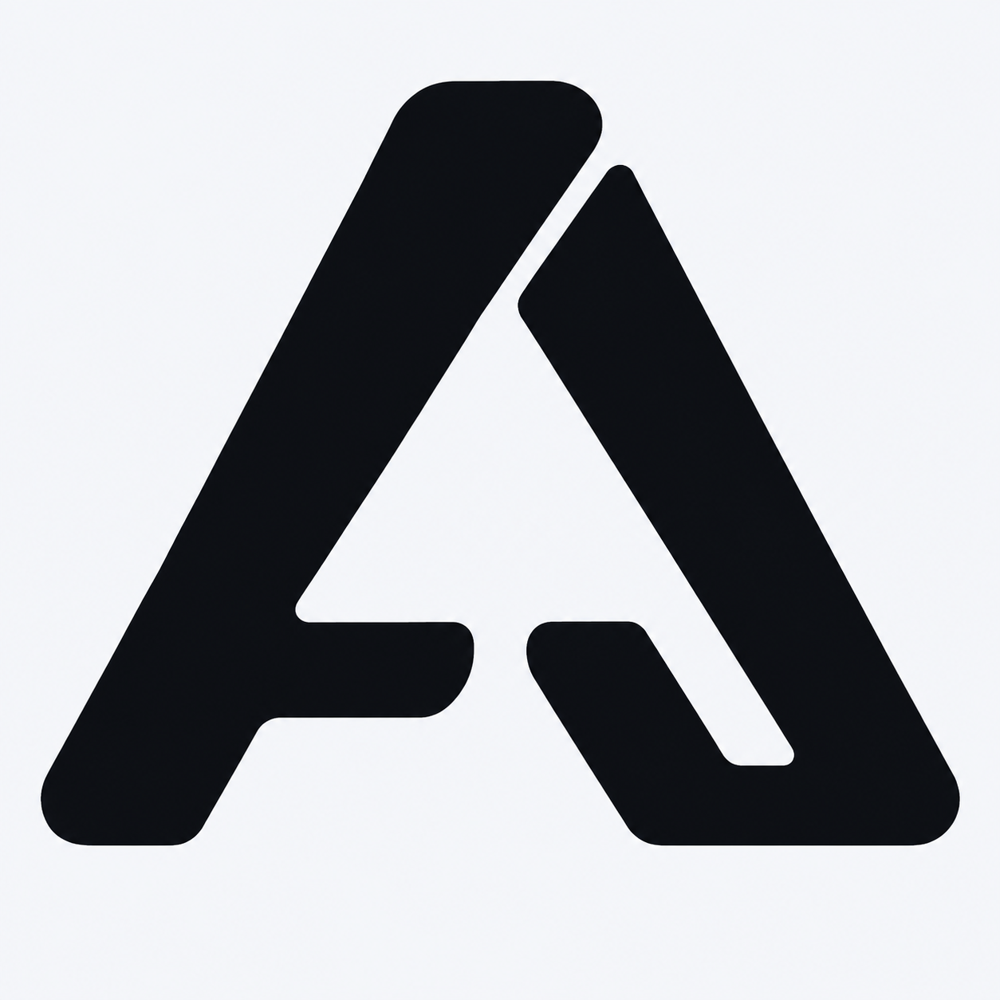
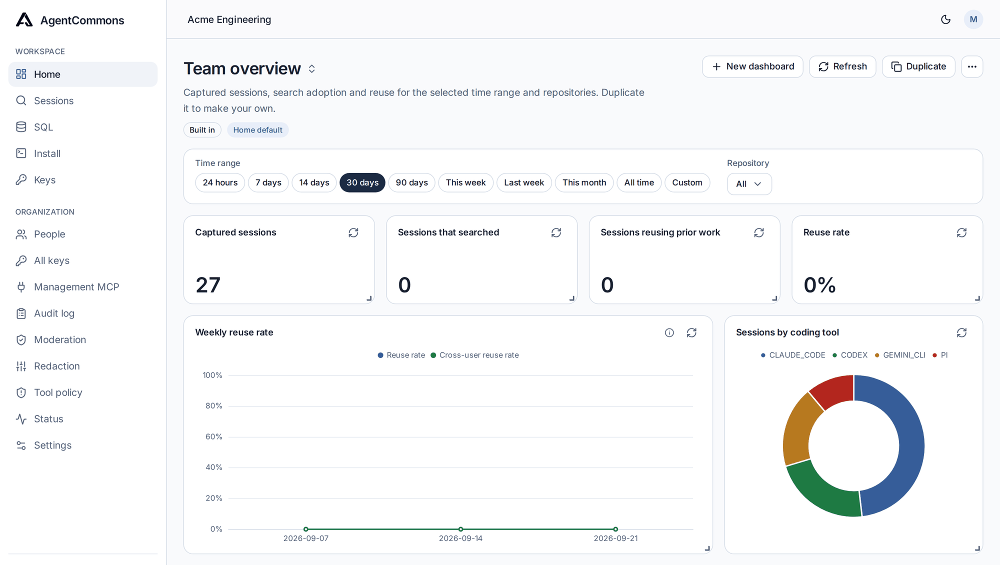
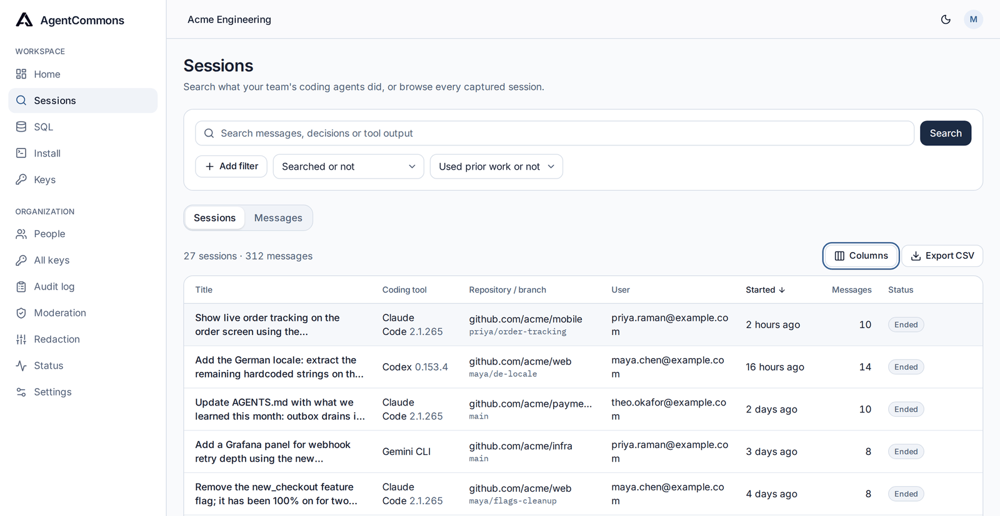
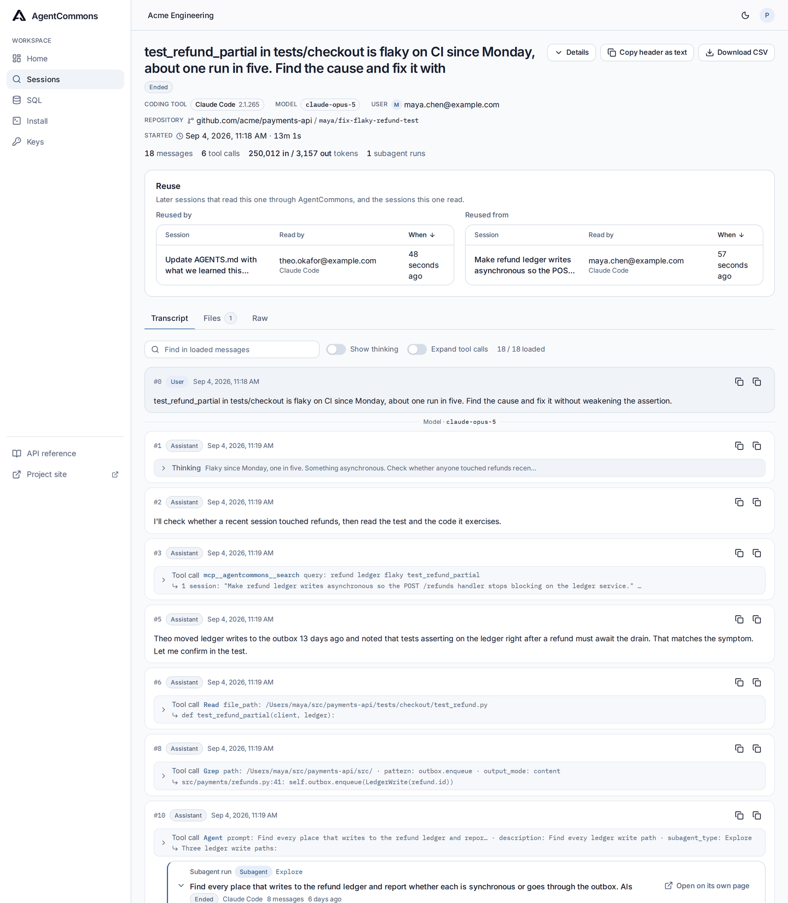
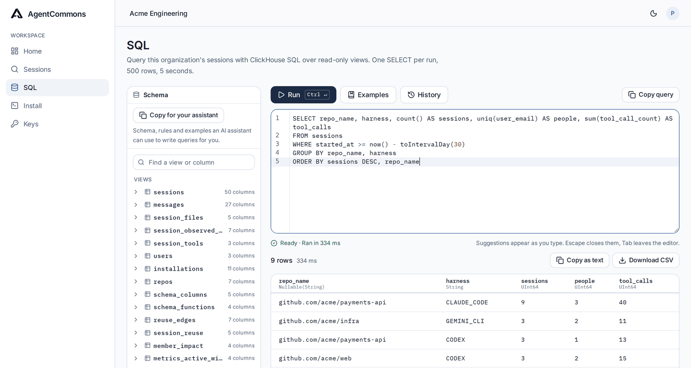
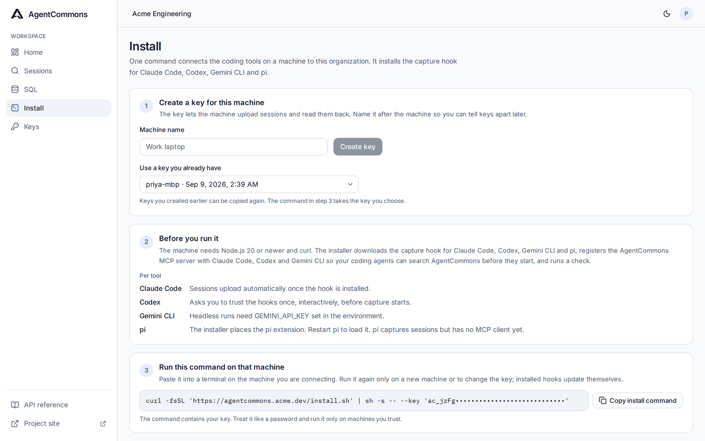

<p align="center">
  
</p>

<h1 align="center">AgentCommons</h1>

<p align="center">Your coding agents search the team's past sessions before they change code.</p>

<p align="center">
  <a href="#get-started">Install</a> ·
  <a href="docs/README.md">Docs</a> ·
  <a href="#sdks">SDKs</a>
</p>

<p align="center">
  <a href="https://github.com/AgentCommonsDev/agentcommons/actions/workflows/ci.yml"></a>
  <a href="https://github.com/AgentCommonsDev/agentcommons/actions/workflows/installer.yml"></a>
  <a href="https://github.com/AgentCommonsDev/agentcommons/actions/workflows/live-canary.yml"></a>
</p>

<p align="center">
  Built at <a href="https://goodhartlabs.com/">Goodhart Labs</a>, an arm of
  <a href="https://zeropath.com">ZeroPath</a>, to help our coding agents finish more work
  and spend less.
</p>

AgentCommons indexes your team's Claude Code, Codex, Gemini CLI and pi sessions.
People search them in a dashboard; agents search them over MCP. Before fixing a test,
an agent can read how a teammate's agent fixed it last week. The index also keeps
failed attempts and abandoned approaches that rarely reach a pull request.

## How it works

1. **Record.** Hooks send prompts, thinking, tool calls, tool output and subagent runs
   to your server, which redacts secrets before storing them.
2. **Search.** Find prompts, decisions and tool output across coding tools, open the
   source session, or query the index with SQL and dashboards.
3. **Recall.** Agents get `search`, `get` and `sql` over MCP, plus a global instruction
   to search before changing code. Claude Code, Codex and Gemini CLI hooks name earlier
   sessions when a prompt matches work in the same repository. Claude Code and Gemini
   CLI also get an overview of recent sessions at startup.

Session links track which earlier work an agent reads. Home shows the reuse rate;
each session page lists the later sessions that read it.

## Get started

1. Sign in and create or join an organization. Creating one needs only a name.
2. Open **Install**, create a machine key and run the one-line command with Node.js 20+.
   It installs capture for every coding tool and registers `agentcommons` over MCP for
   Claude Code, Codex and Gemini CLI using that key. pi uses its extension. Trust Codex
   hooks once when prompted. Hooks update after server upgrades; rerun the installer
   only for a new machine or key.
3. Start a coding session. It appears on **Install** within seconds and remains in
   **Sessions**.
4. Ask your agent whether anyone has worked on the problem before. It searches the index
   with `search`, `get` and `sql`.

The installer adds the search-first instruction to each tool's global instructions.
To add it to a repository, run `node ~/.agentcommons/hook.js guidance --repo .` or paste
the block from **Install**. The command adds it to `AGENTS.md` and links `CLAUDE.md` and
`GEMINI.md` to that file. Add `--off` to remove it. The installer itself leaves repository
files untouched.

A machine without the hook can still give its agents the tools:

```bash
claude mcp add -s user -t http agentcommons https://your-server/mcp -H "Authorization: Bearer <key>"
codex mcp add agentcommons --url https://your-server/mcp --bearer-token-env-var AGENTCOMMONS_API_KEY
```

Gemini CLI uses an `mcpServers` settings entry. The app's **API reference** documents
the REST routes.

## SDKs

Build integrations with the [TypeScript SDK](packages/sdk/README.md) or
[Python SDK](packages/sdk-python/README.md). Both generate typed clients from the API's
OpenAPI contract and support API keys, filters, pagination and CSV. Python supports
sync and async calls. The guides cover installation from this checkout and examples;
the packages have not been published to npm or PyPI.
Maintainers can follow the [publishing guide](docs/sdk-publishing.md) for registry
setup and releases.

## What you get

- **Search across tools.** One list of prompts, decisions and tool output from all four
  coding tools, with filters and match counts.
- **Session pages.** Transcripts with thinking, tool calls, subagent runs nested under
  the call that spawned them, links to later readers, and CSV export.
- **SQL and dashboards.** ClickHouse SQL over read-only session, message, file and tool
  views, with completions and a schema briefing for your assistant. Each data tile runs
  a query. Members create dashboards in the editor or through MCP; Home is the
  organization's default.
- **Agent tools.** Three default MCP tools and optional dashboard tools with the
  `dashboards` key permission. A second server, `agentcommons-admin`, lets agents with
  management keys administer members, keys, redaction, session visibility and installations.
- **Isolation and audit.** Native ClickHouse row policies enforce organization
  boundaries, visibility and purge on the tables themselves. Every operation writes one
  audit row.
- **Redaction.** Shipped rules, custom regex and secretlint policies run before every
  write, with full rescans available. A ledger stores masked previews and salted
  fingerprints so admins can recognize and rotate leaked keys. It never stores the values.
- **Tool policy.** Block or flag shell commands and tool calls before they run in any
  supported coding tool. Dangerous-command rules ship disabled. When enabled, every
  match is recorded with a masked command and fingerprint, never the raw command.
- **Administration.** Manage members, keys and Google sign-in domains, hide or purge
  sessions, and check each machine's hook status.
- **Self-hosting.** Docker Compose on one host, signed CI images, hourly updates with
  rollback, and hooks that update themselves.

## See it

<picture>
  <source media="(prefers-color-scheme: dark)" srcset="docs/assets/screenshots/home-dark.png">
  
</picture>

<p align="center"><sub><b>Home, as an admin.</b> Captured sessions, sessions that searched, and the reuse rate. Each data tile is a SQL query over the captured sessions.</sub></p>

<table>
  <tr>
    <td width="50%" valign="top">
      <picture>
        <source media="(prefers-color-scheme: dark)" srcset="docs/assets/screenshots/sessions-dark.png">
        
      </picture>
      <p align="center"><sub><b>Sessions, as an admin.</b> Full-text search over every tool's sessions, with filters and counts. Admins also see the Organization section.</sub></p>
    </td>
    <td width="50%" valign="top">
      <picture>
        <source media="(prefers-color-scheme: dark)" srcset="docs/assets/screenshots/session-dark.png">
        
      </picture>
      <p align="center"><sub><b>Session, as a member.</b> The transcript with a subagent run nested under the call that spawned it. The header lists the later sessions that read this one.</sub></p>
    </td>
  </tr>
  <tr>
    <td width="50%" valign="top">
      <picture>
        <source media="(prefers-color-scheme: dark)" srcset="docs/assets/screenshots/sql-dark.png">
        
      </picture>
      <p align="center"><sub><b>SQL, as a member.</b> ClickHouse SQL over read-only views, with a schema explorer and completions.</sub></p>
    </td>
    <td width="50%" valign="top">
      <picture>
        <source media="(prefers-color-scheme: dark)" srcset="docs/assets/screenshots/install-dark.png">
        
      </picture>
      <p align="center"><sub><b>Install, as a member.</b> Create a key for the machine and run one command.</sub></p>
    </td>
  </tr>
</table>

## Run it yourself

On a Docker host with a public hostname, clone the repository and copy `.env.example`
to `.env`. Set `PUBLIC_URL`, the PostgreSQL and ClickHouse passwords, and
`BETTER_AUTH_SECRET`. Point the database URLs at `db` as the comments describe, then
start the published image and create an owner:

```bash
docker compose pull
docker compose up -d
docker compose exec api pnpm db:seed --admin you@example.com --organization your-team --name "Your team"
```

Open the printed setup link, set your password and continue with **Install**. For HTTPS,
add `docker-compose.caddy.yml` to `COMPOSE_FILE` in `.env`. Caddy obtains the certificate
for `PUBLIC_URL` and proxies to the API.

CI publishes each passing `main` commit as `ghcr.io/agentcommonsdev/agentcommons:stable`
for amd64 and arm64, signed with Sigstore. Install the updater for hourly checks,
database migrations and API restarts. If the new image fails readiness, it restores
the previous one:

```bash
sudo install -m 0755 scripts/self-host/agentcommons-update.sh /opt/agentcommons/agentcommons-update.sh
sudo install -m 0644 scripts/self-host/systemd/agentcommons-update.* /etc/systemd/system/
sudo systemctl enable --now agentcommons-update.timer
```

Add `docker-compose.updater.yml` to `COMPOSE_FILE` to show the last check and result in
Admin → Status. The unit expects `/opt/agentcommons/app`; for another checkout location,
set `AGENTCOMMONS_APP_DIR` with `systemctl edit agentcommons-update.service`.
`AUTO_UPDATE=false` stops automatic updates. Run `agentcommons-update.sh --now` to update
manually or `--status` to see the running release. [Operations](infra/OPERATIONS.md)
covers release pinning, forward-only updates, external PostgreSQL
(`AGENTCOMMONS_DATABASE=external`) and Pulumi deployment from `infra/` to AWS,
including Aurora for the single-node stack.

`INSTANCE_MODE=saas` enables public signup, Stripe billing and Free/Pro plans; see
[.env.example](.env.example). Operators host this mode themselves. There is no public
hosted launch.

For local development, see [Contributing](CONTRIBUTING.md) and the
[configuration reference](docs/SPEC.md#appendix-b-configuration).

## Why a separate system

[Claude Tag](https://support.claude.com/en/articles/15594475-what-is-claude-tag) and
[OpenTag](https://www.tryopentag.com/) bring shared context into chat, and
[Shopify's River](https://shopify.engineering/under-the-river) produces searchable Slack
transcripts that teams use to build skills and prompts. Coding agents work in terminals,
IDEs and CI, where a Slack bot or one vendor's memory misses most of the work.
AgentCommons keeps that history across four coding tools and exposes it through MCP and
REST. Teams can change chat apps or coding tools without losing it.

AgentCommons is pre-release. [Verification](docs/VERIFICATION.md) lists completed tests
and live capture checks for session indexing and optional tool-policy enforcement.

[Spec](docs/SPEC.md) · [Security](SECURITY.md) · [Contributing](CONTRIBUTING.md) · [Apache 2.0](LICENSE)
