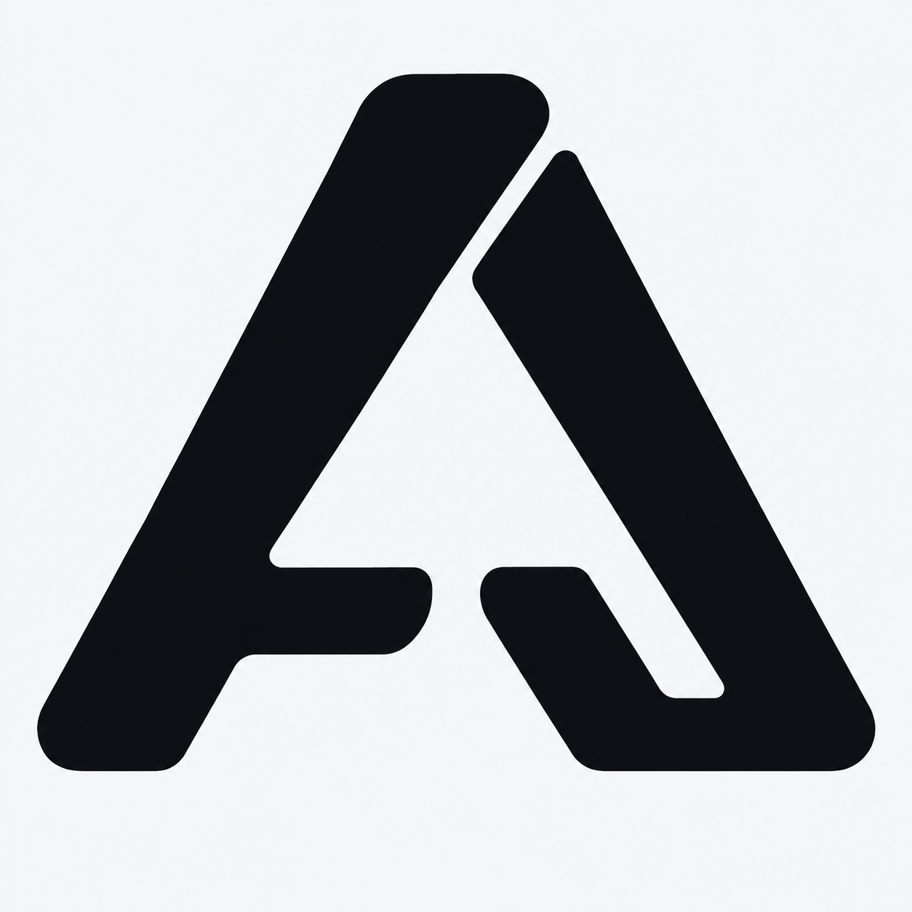
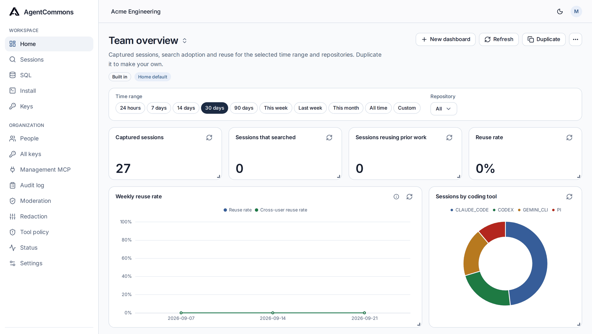
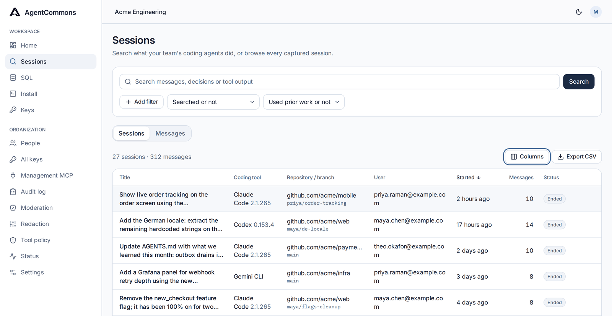
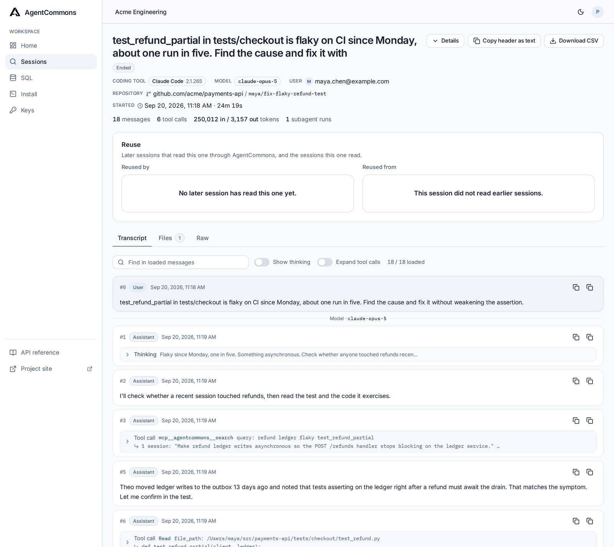
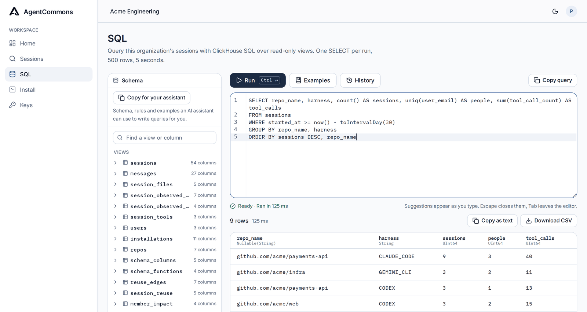
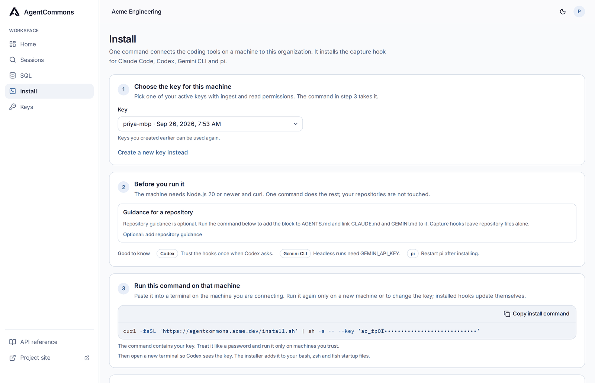

<p align="center">
  
</p>

<h1 align="center">AgentCommons</h1>

<p align="center">Your coding agents search the team's past sessions before they change code.</p>

<p align="center">
  <a href="#get-started">Install</a> ·
  <a href="docs/README.md">Docs</a>
</p>

<p align="center">
  <a href="https://github.com/AgentCommonsDev/agentcommons/actions/workflows/ci.yml"></a>
  <a href="https://github.com/AgentCommonsDev/agentcommons/actions/workflows/installer.yml"></a>
  <a href="https://github.com/AgentCommonsDev/agentcommons/actions/workflows/live-canary.yml"></a>
</p>

<p align="center">
  Built internally at <a href="https://goodhartlabs.com/">Goodhart Labs</a>, an arm of
  <a href="https://zeropath.com">ZeroPath</a>, to make our own coding agents more productive
  and cut their spend. Source at <a href="https://github.com/Goodhart-Labs">github.com/Goodhart-Labs</a>.
</p>

AgentCommons records every Claude Code, Codex, Gemini CLI and pi session on your team's
machines into one searchable index. People search it in a dashboard. Agents search the
same index over MCP, so an agent about to fix a test can first read the session where a
teammate's agent fixed the same test last week. Failed attempts and abandoned approaches
rarely reach a pull request; the index keeps them.

## How it works

1. **Record.** A hook in each coding tool ships the transcript to your server: prompts,
   thinking, tool calls, tool output and subagent runs. The server redacts secrets before
   it stores anything.
2. **Search.** Teammates search prompts, decisions and tool output across every tool, open
   the source session, and query all of it with SQL and dashboards.
3. **Recall.** Agents get three MCP tools, `search`, `get` and `sql`, and a standing
   instruction in their global instructions files to search before changing code. In Claude
   Code, Codex and Gemini CLI the hook also names earlier sessions on the same repository when a prompt matches one; Claude Code and Gemini CLI get an overview
   of the newest ones at session start.

AgentCommons links a session to the earlier sessions it reads, so Home shows how much
prior work is reused and each session page lists the later sessions that read it.

## Get started

1. Sign in and create or join your organization. It needs only a name.
2. Open **Install**, create a key for your machine and run the one-line command in a
   terminal with Node.js 20 or newer. It installs the capture hook for every coding tool on
   the machine and registers the `agentcommons` MCP server for Claude Code, Codex and Gemini
   CLI with the same key; pi reaches the same tools through its extension. Codex asks you to
   trust the hooks once. Installed hooks update themselves after a server upgrade, so run
   the installer again only on a new machine or for a new key.
3. Start a coding session. It appears on the Install page within seconds and stays under
   **Sessions**.
4. Ask your agent whether anyone has worked on the problem before. It answers from
   `search`, `get` and `sql`.

The installer writes the search-first instruction into each tool's global instructions
file on that machine. Repository files change only when you explicitly run
`node ~/.agentcommons/hook.js guidance --repo .` in a checkout or paste the block from
**Install**. The command adds the block to `AGENTS.md` and links `CLAUDE.md` and
`GEMINI.md` to it. Add `--off` to remove the block from a repository.

A machine without the hook can still give its agents the tools:

```bash
claude mcp add -s user -t http agentcommons https://your-server/mcp -H "Authorization: Bearer <key>"
codex mcp add agentcommons --url https://your-server/mcp --bearer-token-env-var AGENTCOMMONS_API_KEY
```

Gemini CLI takes an `mcpServers` entry in its settings. The **API reference** page in the
app documents the same routes over REST.

## What you get

- **Search across tools.** Prompts, decisions and tool output from Claude Code, Codex,
  Gemini CLI and pi in one list, with filters and match counts.
- **Session pages.** The transcript with thinking, tool calls and subagent runs nested
  under the call that spawned them, the later sessions that read it, and a CSV export.
- **SQL and dashboards.** ClickHouse SQL over read-only views of sessions, messages, files
  and tools, with completions and a schema briefing to paste into your assistant. Home is
  the organization's default dashboard; each data tile is a query, and members add
  dashboards in the editor or through MCP.
- **Agent tools.** `search`, `get` and `sql` over MCP by default. Dashboard tools appear
  when a key grants the `dashboards` group. A second server, `agentcommons-admin`, gives an
  agent with a management key the administration tools for members, keys, redaction,
  session visibility and installations.
- **Isolation and audit.** Native ClickHouse row policies enforce organization
  boundaries, visibility and purge on the tables themselves. Every operation writes one
  audit row.
- **Redaction.** Runs before every write, from shipped rules plus your own regex and
  secretlint policies, with a full rescan. The ledger keeps a masked preview and a salted
  fingerprint per hit, never the value, so an admin can recognize and rotate a leaked key.
- **Tool policy.** Rules that block or flag a shell command or tool call before it runs,
  across every coding tool. A preset of dangerous-command guardrails ships turned off. Turn
  it on and every match is recorded with the command masked and fingerprinted, never raw.
- **Administration.** Members, keys and Google sign-in domains. Hide or purge sessions.
  See each machine's hook status.
- **Yours to run.** One Docker Compose host, signed images from CI, an hourly updater with
  rollback, and hooks that update themselves.

## See it

<picture>
  <source media="(prefers-color-scheme: dark)" srcset="docs/assets/screenshots/home-dark.png">
  
</picture>

<p align="center"><sub><b>Home, as an admin.</b> Captured sessions, sessions that searched, and the reuse rate. Each data tile is a SQL query over the captured sessions.</sub></p>

<table>
  <tr>
    <td width="50%" valign="top">
      <picture>
        <source media="(prefers-color-scheme: dark)" srcset="docs/assets/screenshots/sessions-dark.png">
        
      </picture>
      <p align="center"><sub><b>Sessions, as an admin.</b> Full-text search over every tool's sessions, with filters and counts. Admins also see the Organization section.</sub></p>
    </td>
    <td width="50%" valign="top">
      <picture>
        <source media="(prefers-color-scheme: dark)" srcset="docs/assets/screenshots/session-dark.png">
        
      </picture>
      <p align="center"><sub><b>Session, as a member.</b> The transcript with a subagent run nested under the call that spawned it. The header lists the later sessions that read this one.</sub></p>
    </td>
  </tr>
  <tr>
    <td width="50%" valign="top">
      <picture>
        <source media="(prefers-color-scheme: dark)" srcset="docs/assets/screenshots/sql-dark.png">
        
      </picture>
      <p align="center"><sub><b>SQL, as a member.</b> ClickHouse SQL over read-only views, with a schema explorer and completions.</sub></p>
    </td>
    <td width="50%" valign="top">
      <picture>
        <source media="(prefers-color-scheme: dark)" srcset="docs/assets/screenshots/install-dark.png">
        
      </picture>
      <p align="center"><sub><b>Install, as a member.</b> Create a key for the machine and run one command.</sub></p>
    </td>
  </tr>
</table>

## Run it yourself

You need Docker and a host with a public hostname. Clone the repository, copy
`.env.example` to `.env`, set `PUBLIC_URL`, the PostgreSQL and ClickHouse passwords and
`BETTER_AUTH_SECRET`, and point the database URLs at host `db` as the comments describe.
Then start the published image and create an owner:

```bash
docker compose pull
docker compose up -d
docker compose exec api pnpm db:seed --admin you@example.com --organization your-team --name "Your team"
```

The seed prints a setup link. Open it, set your password and continue with **Install**.
For HTTPS on one host, add `docker-compose.caddy.yml` to `COMPOSE_FILE` in `.env`; Caddy
obtains the certificate for `PUBLIC_URL` and proxies to the API.

CI publishes every passing commit on `main` as
`ghcr.io/agentcommonsdev/agentcommons:stable` for amd64 and arm64, signed with Sigstore.
Install the updater once and the host picks up releases on its own. It checks hourly,
migrates the databases, restarts the API and puts the previous image back if the new one
does not become ready:

```bash
sudo install -m 0755 scripts/self-host/agentcommons-update.sh /opt/agentcommons/agentcommons-update.sh
sudo install -m 0644 scripts/self-host/systemd/agentcommons-update.* /etc/systemd/system/
sudo systemctl enable --now agentcommons-update.timer
```

Add `docker-compose.updater.yml` to `COMPOSE_FILE` so Admin → Status shows the updater's
last check and result. The unit expects the checkout at `/opt/agentcommons/app`; set
`AGENTCOMMONS_APP_DIR` with `systemctl edit agentcommons-update.service` if yours lives
elsewhere. `AUTO_UPDATE=false` in `.env` stops automatic updates;
`agentcommons-update.sh --now` updates by hand and `--status` shows the running release.
[infra/OPERATIONS.md](infra/OPERATIONS.md) covers the rest: pinning a release, the
updater's forward-only rule, an external PostgreSQL (`AGENTCOMMONS_DATABASE=external`), and
AWS deployment with Pulumi from `infra/`, including Aurora for the single-node stack.

`INSTANCE_MODE=saas` turns on public signup, Stripe billing and the Free and Pro plans
described in [.env.example](.env.example). Operators run this mode themselves; no public
hosted launch is implied.

For local development, see [Contributing](CONTRIBUTING.md) and the
[configuration reference](docs/SPEC.md#appendix-b-configuration).

## Why a separate system

[Claude Tag](https://support.claude.com/en/articles/15594475-what-is-claude-tag) and
[OpenTag](https://www.tryopentag.com/) bring shared context into chat, and
[Shopify's River](https://shopify.engineering/under-the-river) leaves searchable Slack
transcripts that teams mine for skills and prompts. Coding agents work in terminals, IDEs
and CI, so a bot in Slack or one vendor's session memory misses most of the work and ties
the record to that vendor. AgentCommons indexes the work where it happens, across four
coding tools and anything that can call MCP or REST, so a team can change chat apps or
coding tools and keep its history.

AgentCommons is pre-release. It records and indexes sessions, and an optional tool policy
blocks or flags tool calls before they run. [Verification](docs/VERIFICATION.md) lists the
completed tests and live capture checks.

[Spec](docs/SPEC.md) · [Security](SECURITY.md) · [Contributing](CONTRIBUTING.md) · [Apache 2.0](LICENSE)
